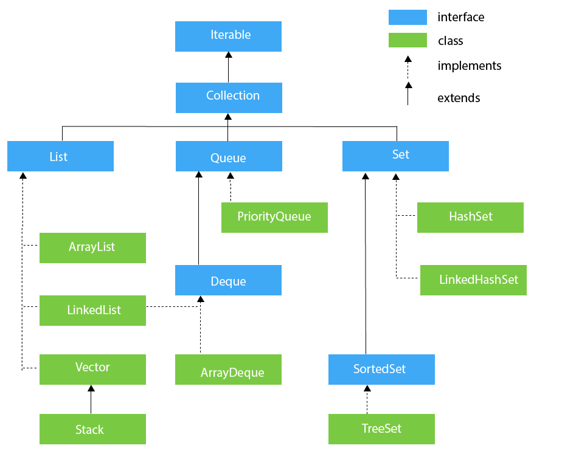

# 113. Collections Framework

**Section:** Java Collections Framework  
**Level:** Beginner → Intermediate

1. Hierarchy of Collection Framework
2. What is Collection Framework
3. Iterable Interface
4. Iterator Interface
                  


## Hierarchy of Collection Framework



##1. What is Collection Framework?
- The Collection Framework is a set of classes and interfaces used to store and manage data. 
- It provides different data structures like lists, sets, and queues.

 **Interfaces**
  - Interable
  - Collection
  - List
  - Queue
  - Deque
  - Set
  - SortedSet
  
 **Classes**
 - ArrayList
 - LinkedList
 - PriorityQueue
 - HashSet
 - LinkedHashSet
 - TreeSet
 
 ##2. Iterable Interface
The Iterable interface is the root interface for all the collection classes. The Collection interface extends the Iterable interface, and therefore, all the subclasses of the Collection interface also implement the Iterable interface.

**It contains only one abstract method. i.e**
```
Iterator<T> iterator()  
```

```
import java.util.*;  
  
public class IterableExample {  
    public static void main(String[] args) {  
        Iterable<String> list = new ArrayList<>();  
  
        list.add("Rahul");  
        list.add("Priya");  
        list.add("Amit");  
  
        for (String name : list) {  
            System.out.println(name);  
        }  
    }  
}  
```

Output:
```
Rahul
Priya
Amit
```

   
  ##3. Iterator Interface
 The Iterator interface is used to traverse elements of a collection one by one. It allows only forward direction traversal. It also provides methods to remove elements while iterating.
 
 ```
import java.util.*;  
  
public class IteratorExample {  
    public static void main(String[] args) {  
        Collection<String> list = new ArrayList<>();  
  
        list.add("Rahul");  
        list.add("Priya");  
        list.add("Amit");  
  
        Iterator<String> itr = list.iterator();  
  
        while (itr.hasNext()) {  
            System.out.println(itr.next());  
        }  
    }  
}  
```

**Out put**
```
Rahul
Priya
Amit
```
 


---

[← 112. Try-with-resources](../07_Exception_Handling/112_Try-with-resources.md) | [Course Index](../README.md) | [114. Collection →](114_Collection.md)
