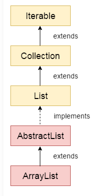

# 116. ArrayList

**Section:** Java Collections Framework  
**Level:** Beginner → Intermediate

## 1. What is the ArrayList?

- ArrayList is a resizable (dynamic) array that is part of the Java Collections Framework.
- It allows you to store elements dynamically without worrying about the initial size.

## 2. Key Features of Java ArrayList

- **Maintains Insertion Order** - Java ArrayList guarantees the order in which elements are fed into it. When going through the ArrayList with the iterating process, elements are accessed in the same sequence they were added.
- **Non-Synchronized** - Unlike some other Java collection classes (for instance, Vector), ArrayList is not synchronized. This fact implies that ArrayList is not thread-safe; therefore, concurrent modification issues might arise if multiple threads access ArrayList concurrently.
- **Supports Random Access** - ArrayList allows the implementation of fast random access operations using the elements' index positions. This is because an array structure is used for internal implementation, which ensures constant-time access to elements via index.
- **Slower Manipulation compared to LinkedList** - Manipulation operations, such as insertion and deletion, can be slower in ArrayList than in LinkedList. Thus, ArrayList has to perform the shifting of the elements when items are inserted or removed from anywhere except the end of the list. However, it is effortless to add or delete an element in a LinkedList, and no shifting will be needed.
- **Dynamic Resizing** - ArrayList expands or contracts when adding or removing elements to meet the required new size. Due to adaptive resizing, online collections can be managed without physical resizing.
- **Capacity** -  ArrayList has an initial capacity, which is the number of elements it can keep without reallocation. If the number of elements cannot fit into this capacity, the List automatically enlarges the size to accommodate the rest of the elements. Copying all the elements to the new, larger array may be involved.
- **Iterable** - ArrayList implements the `Iterable` interface. Therefore, we can easily iterate the elements using enhanced for loops or iterators.
- **Dynamic Initialization** - Java ArrayList is initialized without specifying its size. Unlike traditional arrays, where you must declare a fixed size, ArrayList dynamically adjusts its size based on the number of elements added or removed. This dynamic sizing eliminates the need to preallocate memory or worry about exceeding array bounds, providing more flexibility in managing collections.

## 3. Hierarchy of ArrayList Class
The Java ArrayList class is part of the Java Collections Framework and follows a hierarchical structure.

- ArrayList extends the AbstractList class
- AbstractList implements the List interface
- The List interface extends the Collection interface
- The Collection interface further extends the Iterable interface




**This example demonstrates how to iterate through an ArrayList using the Iterator interface in Java.**
```
import java.util.*;  
public class Main{  
 public static void main(String args[]){  
  ArrayList<String> list=new ArrayList<String>();//Creating arraylist  
  list.add("Mango");//Adding object in arraylist    
  list.add("Apple");    
  list.add("Banana");    
  list.add("Grapes");    
  //Traversing list through Iterator  
  Iterator itr=list.iterator();//getting the Iterator  
  while(itr.hasNext()){//check if iterator has the elements  
   System.out.println(itr.next());//printing the element and move to next  
  }  
 }  
}  

```

**Out put**
```
Mango
Apple
Banana
Grapes
```

## 4. Get and Set Elements in ArrayList

You can access and modify elements in an ArrayList using the get() and set() methods.

 - **get(index):** This method retrieves element at a specific index
 - **set(index, value):** This method replaces element at a specific index
 
 ```
      list.set(1, "Dates");  
```
## 5. How to Sort ArrayList

You can sort an ArrayList using the Collections.sort() method from the java.util package.
```
 List<String> list1 = new ArrayList<>();  
        list1.add("Mango");  
        list1.add("Apple");  
        list1.add("Banana");  
        list1.add("Grapes");  
  
        Collections.sort(list
```

## 6. Iterating Collection through Other Ways

You can traverse an ArrayList using multiple methods like ListIterator, for loop, forEach(), and forEachRemaining().
```
import java.util.*;  
  
class Main {  
    public static void main(String args[]) {  
        ArrayList<String> list = new ArrayList<>();  
  
        list.add("Ravi");  
        list.add("Vijay");  
        list.add("Ravi");  
        list.add("Ajay");  
  
        System.out.println("ListIterator (reverse):");  
        ListIterator<String> it = list.listIterator(list.size());  
        while (it.hasPrevious()) {  
            System.out.println(it.previous());  
        }  
  
        System.out.println("For loop:");  
        for (int i = 0; i < list.size(); i++) {  
            System.out.println(list.get(i));  
        }  
  
        System.out.println("forEach():");  
        list.forEach(a -> System.out.println(a));  
  
        System.out.println("forEachRemaining():");  
        Iterator<String> itr = list.iterator();  
        itr.forEachRemaining(a -> System.out.println(a));  
    }  
}  
```

## Output:
```
ListIterator (reverse):
Ajay
Ravi
Vijay
Ravi
For loop:
Ravi
Vijay
Ravi
Ajay
forEach():
Ravi
Vijay
Ravi
Ajay
forEachRemaining():
Ravi
Vijay
Ravi
Ajay
```

---

[← 115. List](115_List.md) | [Course Index](../README.md) | [117. LinkedList →](117_LinkedList.md)
